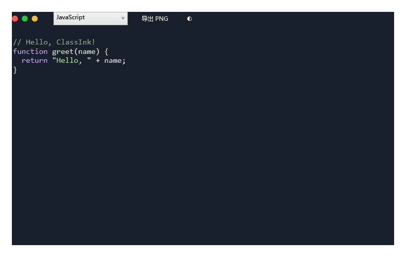
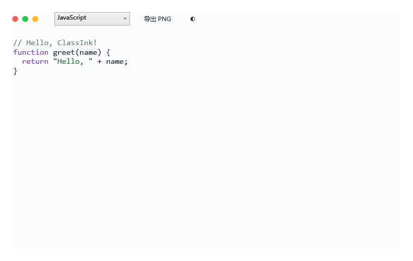
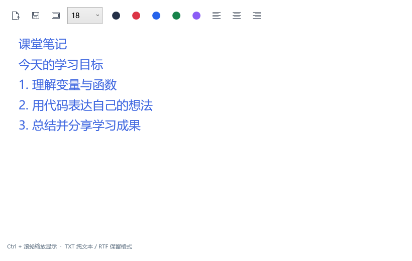

# 课堂笔 ClassInk

**Windows v1.7.0 · 屏幕标注、板书、放大镜与课堂创作工具**

把课件重点直接画在屏幕上，用多页白板整理思路，用便笺和代码卡片制作课堂素材，再用倒计时和抽奖组织互动。

[下载最终版 ClassInk.exe](https://github.com/Crazyer-Flove/ClassInk/releases/latest/download/ClassInk.exe) · [版本说明](https://github.com/Crazyer-Flove/ClassInk/releases/tag/v1.7.0) · [更新日志](CHANGELOG.md) · [MIT 许可证](LICENSE)

## 目录

- [安装与更新](#安装与更新)
- [功能总览](#功能总览)
- [界面与功能展示](#界面与功能展示)
- [文本便笺详细操作](#文本便笺详细操作)
- [代码块详细操作](#代码块详细操作)
- [抽奖大转盘详细操作](#抽奖大转盘详细操作)
- [屏幕缩放与局部放大镜](#屏幕缩放与局部放大镜)
- [保存与导出如何选择](#保存与导出如何选择)
- [常见问题](#常见问题)
- [一节课怎么用](#一节课怎么用)
- [工具和设置](#工具和设置)
- [源码与构建](#源码与构建)

## 安装与更新

1. 下载发布页的 **ClassInk.exe**，适用于 Windows 10 / 11 x64。
2. 双击运行，通过屏幕上的悬浮球展开工具栏；无需安装。
3. 初始为鼠标模式，点击画笔才开始屏幕标注。
4. 更新前手动保存课程或便笺，退出旧版，然后用新版替换旧 EXE。
5. 程序有跨文件名的单实例检测；重复启动不会产生第二个悬浮球。

程序使用 Windows .NET Framework 4.x / WPF，在本机处理内容。发布目录只需要一个 EXE，不需要将源码和图片资源放在旁边。仓库中的 `dist/` 不提交到 Git，最终程序通过 Releases 下载。

**macOS 是独立预览版。** 面向 macOS 13 及以上的 Apple Silicon / Intel，包含主屏幕画笔、穿透、板面、缩放、撤销及 PNG 输出等基础能力。本文新增加的便笺、代码卡片、局部放大镜和抽奖描述针对 Windows，不代表 macOS 已同步实现。Mac 可执行 `bash macos/build.sh` 构建；屏幕缩放需要屏幕录制权限，预览包尚未通过 Apple 公证。

## 功能总览

| 功能 | 能做什么 | 入口 |
| --- | --- | --- |
| 屏幕标注 | 画笔、荧光笔、激光笔、图形、文字 | 悬浮工具栏 |
| 多页板书 | 白板、黑板、绿板、缩略图、复制与翻页 | 板面和页码分组 |
| 全屏缩放 | 放大屏幕快照、平移、临时写画 | Ctrl + 1 |
| 局部放大镜 | 毛玻璃圆角框、五档尺寸、固定位置 | 独立放大镜工具组 |
| 文本便笺 | 分段、颜色、字号、对齐、TXT / RTF / PNG | 课堂工具组 |
| 代码块 | 单栏代码编辑、基础语法高亮、黑白风格、PNG | 课堂工具组 |
| 抽奖 | 自定义奖项、旋转动画、音效、随机结果 | 课堂工具组 |
| 倒计时 | 时分秒设置、预设、提醒音效 | 时钟图标 |
| 课程导出 | 可编辑课程、当前页 PNG、屏幕 PNG、整课 PDF | 文件工具组 |

### 工具组怎么切换

文本便笺、代码块和抽奖收纳在**同一个图标位置**。悬停、点击或右键打开横向图标面板，点击对应图标进入。工具按钮获得焦点后，可以按左右键切换；鼠标悬停滚轮切换选项后，点击执行。主图标会随选择更新。

## 界面与功能展示

以下为 **v1.7.0 程序控件实际渲染的展示图**，示例内容仅用于演示。图片不包含操作系统标题栏；系统 DPI、字体和窗口尺寸会影响实际外观。

### 单栏代码块：黑色风格

语言选择、图片导出和黑白切换都位于代码区顶部。没有左右分栏，直接在高亮代码区域输入。



### 同一编辑器：白色风格

切换主题会同时调整背景、普通文字、语法颜色和输入光标；导出图片采用当前主题。



### 文本便笺与导出效果

工具栏使用图标：打开、保存、图片导出、字号、五种颜色以及三种对齐方式。



导出只包含正文及其格式，不包含工具栏和系统标题栏，也不局限于当前可见区域。


### 屏幕工具与倒计时

| 悬浮工具栏 | 图形选择 | 倒计时 |
| --- | --- | --- |
|  |  |  |

## 文本便笺详细操作

### 创建与输入

在课堂工具组选择纸张图标，打开独立编辑窗口。Enter 创建新段落，可以直接输入、粘贴、选中和编辑文字。便笺是独立内容，不会自动成为白板上的文字，也不会写进 `.classink` 课程文件。

### 图标工具栏

| 从左到右 | 用途 | 操作说明 |
| --- | --- | --- |
| 打开 | 读入文件 | 支持 TXT 和 RTF |
| 保存 | 写出文本 | 在文件类型中选择 TXT 或 RTF |
| 图片图标 | 导出 PNG | 输出全部正文，保留颜色、字号和对齐 |
| 数字下拉框 | 设置字号 | 支持 12、16、18、20、24、28、32、40、48 |
| 五个色点 | 设置文字颜色 | 黑、红、蓝、绿、紫 |
| 三个对齐图标 | 段落布局 | 左对齐、居中、右对齐 |

先选中文字，再设置字号与颜色；光标处没有选区时，格式设置用于后续输入。段落对齐作用于选区所在段落。按钮名称可通过悬停提示查看。

### 显示缩放与字号的区别

- **Ctrl + 鼠标滚轮**：只改变编辑区显示比例，范围 50%–300%，向上放大、向下缩小。
- **字号下拉框**：改变文字本身的格式，会影响 RTF 和 PNG。
- 普通滚轮仍用于滚动；Alt 不再作为缩放键。
- 显示缩放不改变保存的字号；导出时按文档格式绘制，换行宽度取编辑区布局。

### TXT、RTF 和 PNG

TXT 保存纯文字与换行，重新打开不会恢复颜色、字号和对齐。RTF 保留富文本格式，适合下次继续编辑。PNG 适合放进课件、聊天或学习资料，使用 2 倍像素输出。长文按完整内容导出，超出图像尺寸上限时提示分段导出。

关闭便笺或打开其他文件**不再询问是否保存**，没有自动保存。需要保留的内容，请主动点击保存；错误提示仍会显示。

## 代码块详细操作

### 编辑窗口

从课堂工具组选择 `</>` 图标。顶部依次提供红、绿、黄圆点、语言选择、导出 PNG 和黑白主题切换。三色圆点是装饰，不是窗口关闭按钮。右侧和底部使用与代码区一致的背景。

直接在代码区输入，普通输入立即刷新颜色；输入法组合阶段使用可见文字，确认后更新高亮。Tab 插入四个空格，Enter 换行。Ctrl + 滚轮只放大或缩小编辑显示，导出仍使用原代码字号。

### 支持的语言

| 选项 | 高亮范围 |
| --- | --- |
| JavaScript / TypeScript | 常见关键字、字符串、数字和注释 |
| Python | 常见关键字、字符串、数字、井号注释 |
| C# / C++ / Java | 常见声明与控制语句、字符串、数字、注释 |
| JSON | 字符串、数字及基本字面量 |
| HTML / CSS | 基础词法着色，便于课堂展示 |
| SQL | 常见 SQL 关键字、字符串、数字和注释 |
| 纯文本 | 不进行语法着色 |

高亮使用轻量词法规则，不是完整语言解析器。复杂嵌套语法、某些多行字符串、模板或嵌入语言可能无法精确识别。本工具不运行代码，也不提供编译、调试、补全或语法检查。

### 导出代码卡片

1. 选择语言并输入内容。
2. 点击半黑半白图标选择黑色或白色主题。
3. 点击「导出 PNG」，选择文件路径。
4. 图片包含三色圆点和完整高亮代码，不包含语言下拉框、主题按钮或窗口标题栏。

导出完成后不弹成功提示。输出为 2 倍像素；极长行或超长代码超过尺寸限制时会提示缩短内容。编辑内容不自动保存为源码文件，关闭前请导出图片或复制代码到其他编辑器。

## 抽奖大转盘详细操作

1. 在同一课堂工具组中选择转盘图标。
2. 展开「编辑奖项」，每行写一个奖项。
3. 支持 2–24 项，每项最多 30 字；空行忽略。
4. 点击开始，奖项编辑暂时禁用，转盘旋转并逐渐减速。
5. 初次停转后会随机跳到另一个区域，以最终「中奖」文字为准。
6. 可以再次抽取；已中奖项目不会自动移除。

每行奖项等概率。如果同一名称写了多行，该名称的总中奖机会会相应增加。抽奖使用系统随机数生成器；最终跳转增加展示悬念，并非额外权重设置。音效随旋转逐渐急促，结束播放开奖音，可取消「音效」勾选。较长名称在扇区中可能省略，最终结果显示奖项文字。奖项列表没有跨运行持久保存。

## 屏幕缩放与局部放大镜

两种缩放均基于**进入时的屏幕快照**，不实时播放底层视频或网页变化。需要更新内容时退出并重新进入。

### 全屏缩放

按 Ctrl + 1 进入或退出。滚轮调整倍率；右键、中键或空格加左键拖动平移。普通左键写画，B / R / G 切换蓝、红、绿，E 清除临时标注，Esc 退出。

### 毛玻璃圆角局部放大镜

使用独立放大镜工具组，边框有半透明模糊与高光，中央内容保持清晰。尺寸按界面逻辑像素计算，并限制在可用屏幕范围内。

| 档位 | 尺寸 | 使用建议 |
| --- | --- | --- |
| 1 | 240 × 160 | 强调按钮或小片段 |
| 2 | 340 × 220 | 查看短句 |
| **3（默认）** | **480 × 320** | 常规课堂讲解 |
| 4 | 640 × 440 | 多行代码或图表 |
| 5 | 800 × 560 | 较大区域展示 |

在横向图标面板选择尺寸；进入后也可按左右键循环，或按 1–5 直选。移动鼠标带动放大框，单击固定或解除固定，滚轮调整 1.25–8 倍，Esc 退出。这里的普通滚轮调倍率，与便笺、代码窗口的 Ctrl + 滚轮显示缩放不同。

## 保存与导出如何选择

| 目标 | 推荐格式 | 是否可继续编辑 |
| --- | --- | --- |
| 下次继续讲同一课程 | `.classink` | 可以，保留多页板书 |
| 发送一页板书 | PNG | 图片不可恢复为笔迹 |
| 分享整节课板书 | PDF | 图像页，不是可编辑课程 |
| 发送当前屏幕讲解 | 屏幕 PNG | 包含屏幕画面及标注 |
| 保存便笺纯文字 | TXT | 可以，不保留排版格式 |
| 保存便笺颜色和字号 | RTF | 可以 |
| 把便笺放到课件 | PNG | 保留外观 |
| 分享高亮代码卡片 | PNG | 保留当前主题及高亮 |

课程、便笺和代码窗口相互独立；保存课程不会一并保存后两者。

## 常见问题

**启动后没看到完整窗口？** 正常情况先显示悬浮球，点击展开工具栏。若旧版仍在运行，先从旧版退出。

**鼠标不能操作下面的课件？** 切回鼠标模式或按 Esc；画笔模式会接收屏幕输入。

**缩放后看不到网页更新？** 当前缩放基于快照，退出并重新进入即可更新。

**为什么 TXT 重新打开没颜色？** TXT 不支持富文本，改用 RTF 保存。

**为什么没有询问保存？** 便笺已按简洁操作设计取消关闭和换文件确认，需要主动保存；主程序退出也不自动保存。

**图片导出没有弹成功消息？** 这是当前行为，请到选择的文件夹查看结果；失败仍显示错误信息。

**Ctrl + 滚轮没改变导出字体？** 该快捷键只改变显示比例。便笺需要调整字号下拉框来改变文档字体大小。

**为什么其他程序响应了快捷键？** 可在设置的快捷键面板检查注册状态；快捷键被占用时需要释放冲突组合。全屏缩放、便笺和代码窗口的操作范围不同。

**多屏或高 DPI 是否完全验证？** 混合 DPI、触控、系统音量、所有中文输入法仍需在实际设备验证。更改显示器布局后建议重启。

---

以下为板书、计时器、快捷键和开发构建的完整参考。

## 一节课怎么用

1. **讲解**时点击悬浮球，选画笔或激光笔，在课件上标出重点。按 `Esc` 或点击鼠标图标回到课件操作。
2. **练习**时点击时钟，分别在时、分、秒上滚动设置时间，点击开始。下一轮可以直接沿用上次时长。
3. **课后保存**时在文件分组里选择保存课程、导出当前页 PNG，或将整节课导出为 PDF。需要继续编辑时保留 `.classink` 文件。

| 常用操作 | 操作方法 |
| --- | --- |
| 切换鼠标与画笔 | `Ctrl + Alt + D`，或者点工具栏图标 |
| 结束文字输入 | `Ctrl + Enter` 提交，`Enter` 换行，`Esc` 取消 |
| 调整笔画粗细 | 选画笔或荧光笔后，在粗细图标上滚动 |
| 清空与恢复 | 点垃圾桶，五秒内可点「撤销」提示 |
| 页面管理 | 点击页码图标查看缩略图，跳页、设标题、复制、删除或恢复；按 `Ctrl + Alt + PageUp` / `PageDown` 翻页 |
| 隐藏与恢复板书 | 点击眼睛图标，或按 `Ctrl + Alt + H` |
| 放大屏幕 | `Ctrl + 1` 或放大镜菜单进入，滚轮缩放、右键拖动平移、左键标注，`Esc` 退出 |
| 缩放标注 | `B` 蓝色、`R` 红色、`G` 绿色、`E` 清除临时笔迹 |
| 滚轮切换工具 | 悬停在画笔、图形、文字、颜色、板面、缩放截图或文件分组上滚动。文件和缩放截图分组切换后点击执行，右键仍可展开菜单 |
| 截图贴图 | 在放大镜菜单选截图，左键框选后自动贴到当前页，可移动或缩放 |
| 计时预设 | 右键时钟，选择 30 秒、3 分钟、10 分钟或自定义时长 |
| 调整计时窗口 | 拖动四边或四角，拖动空白区域移动 |
| 关闭计时窗口 | 点右上角 `×` 或按 `Esc`，计时继续 |

## 工具和设置

**快捷键。** 齿轮 →「快捷键」可查看完整列表和注册状态。`Ctrl+1` 进入或退出缩放，缩放中 `B/R/G` 切换蓝、红、绿，`E` 清空临时笔迹。其他全局快捷键使用 `Ctrl+Alt` 加下列按键。

| 按键 | 操作 |
| --- | --- |
| `D` / `H` | 切换鼠标与画笔 / 隐藏或恢复板书 |
| `P` / `L` / `M` | 画笔 / 激光笔 / 荧光笔 |
| `A` / `R` | 箭头 / 矩形 |
| `T` / `V` / `E` | 文字 / 选择移动 / 橡皮擦 |
| `W` / `C` | 切换板面 / 截图贴到板书 |
| `S` / `O` / `N` | 保存 / 打开 / 新建页 |
| `PageUp` / `PageDown` | 上一页 / 下一页 |
| `Z` / `Y` / `K` | 撤销 / 重做 / 计时器 |

**打赏支持。** Windows 在齿轮菜单点「打赏支持」，macOS 在工具栏点「打赏」。方形码使用支付宝扫描，圆形码使用微信扫描。两张图片均随程序打包。

**多页板书。** 点击缩略图直接跳页，使用「设标题」为当前页命名。「复制页」将当前笔迹和背景复制到下一页，两页可以独立修改。新建空白页沿用当前背景，每页独立记录本次运行内的撤销历史。删除后自动翻到相邻页，至少保留一页。最近删除的页面可从提示或页码菜单恢复。保存 `.classink` 会包含全部页面、标题和当前页码。新版也能打开旧版单页板书。

**文件管理。** 在齿轮设置中选择「文件管理」→「选择文件夹」，可以设定板书的默认保存路径，也可以直接打开该目录。目录会在下次启动后保留，并用于保存课程、打开课程和各类导出对话框。

**导出。** 文件分组提供「导出屏幕 PNG」「导出当前板书 PNG」「导出整节课 PDF」。当前页 PNG 只输出板书，屏幕标注模式下背景透明。PDF 按课程页序输出横向 A4 图像页并标注页码。需要继续编辑时请保留 `.classink` 源文件。

**临时隐藏。** 眼睛图标暂时隐藏笔迹和板面，同时切回鼠标模式。再次点击恢复，选择绘图工具也会恢复显示。

**计时预设。** 右键时钟即可选中预设并开始。想保存自定义时长，先在计时面板设定并应用，再在预设菜单选择「将当前时长存为自定义」。自定义时长保存在本机。

主栏与圆形悬浮球同为 44 像素宽。相似功能按组收纳；悬停、点击或右键分组图标，会从侧边伸展出仅含图标的选项面板，点击选项即选择或执行，名称仅在悬停提示中显示。焦点在分组按钮时也支持键盘左右键切换并展开面板。主栏只保留图标和计时数字。

点击颜色图标展开预设色板，色板中的「+」打开自定义颜色。点击时钟打开简洁倒计时面板。在时、分、秒数字上滚动可直接调节时长。

新版使用跨文件名的单实例锁，重复启动会直接返回。发现还在运行的历史版本时，会提示先退出旧版，不会再创建第二个悬浮球。拖动只移动当前悬浮球，不复制图标。

主工具栏使用线条图标，选中的工具会高亮。颜色区域的「+」打开自定义颜色选择器，可选择任意颜色或输入 RGB 数值，应用于后续画笔、图形及文字。自定义颜色在本次运行内保留。

工具栏为悬浮球下方的窄竖向面板：从上向下展开，向上逐渐收回，配合淡入淡出与缓动。展开约 320 毫秒、收起约 240 毫秒；动画中点击可从当前位置反向衔接。点击悬浮球切换展开与收起。拖动悬浮球时保留当前展开状态。

点击齿轮打开外观设置，可切换白色、黑色、深海青或演示栏主题。主题应用于悬浮球、主工具栏和侧边选项面板，所选皮肤会作为下次启动的默认皮肤。

画笔分组提供激光笔。选中后红色光点跟随鼠标，柔和光晕持续扩散并淡出，点击时重新开始一轮扩散。激光效果不会写入板书。

启动后通过悬浮球操作，主窗口隐藏任务栏按钮。子菜单横向滑入。使用画笔或荧光笔时，在粗细图标上滚动即可循环切换五档。

## 上课使用

1. 启动后默认是鼠标模式，可以操作浏览器、课件、IDE 等下层软件。
2. 点击「画笔」开始在屏幕上标注；也可选荧光笔、文字、直线、箭头、矩形、椭圆。
3. 点击「鼠标」或按 Esc 返回鼠标模式，已有笔迹继续显示。切换工具后，悬浮球旁会短暂显示当前模式。全局快捷键 Ctrl + Alt + D 切换鼠标与画笔。
4. 默认显示左上角的半透明悬浮球。支持鼠标或触屏拖动，拖动不会误展开。点击后在球下方展开竖向工具栏；再次点击悬浮球收起，鼠标移开时保持当前状态。位置在本次运行内保留。靠近底部或右侧展开时会调整位置以保证面板可见，小屏幕等比例缩小。收起后保留当前绘图工具与笔迹，可继续书写；按 Esc 返回鼠标模式。
5. 「橡皮」擦除整条笔迹；「选择」圈选后移动或缩放笔迹与文字。文字右键删除。选中文字工具后，点击屏幕任意位置出现输入光标，直接打字；输入框与已提交文字均使用透明背景，显示下方屏幕内容。Enter 换行，Ctrl+Enter 或点击别处提交，Esc 取消当前输入，不弹文字窗口。输入中的文字提交后才成为可保存的笔迹；点击保存会先提交。按 Ctrl+Enter 或点画布空白处提交后，文字自动出现选框，可拖动或拉角调整字号。
6. 背景分组可切换屏幕标注、白板、黑板和带纹理的墨绿粉笔板。背景随板书保存。
7. 「保存课程」将全部板书页写入 `.classink` 文件。下次用「打开课程」恢复后，可以继续添加、移动或擦除笔迹。课程文件只记录板书内容。
8. 「导出屏幕 PNG」截取整个虚拟桌面（含屏幕内容和笔迹），导出时隐藏工具栏。请在导出前切到要截图的软件。只需分享板书时，选择当前页 PNG 或整课 PDF。
9. 垃圾桶按钮一键清空全部笔迹及文字，不弹确认框；清空后五秒内可点击悬浮球旁的「撤销」，也可使用工具栏的撤销功能。
10. 点击时钟打开半透明圆角矩形倒计时面板，可拖动四边和四角缩放。首次默认五分钟。悬停在时、分、秒数字上会高亮该组，滚动可调整时长。应用后的时长会保存到本机。点击开始应用，计时中同一按钮可暂停。最后十秒每秒播放一次短提示，归零时播放约 1.5 秒的结束音，并显示「时间到」。齿轮设置中的「计时音效」可选清脆铃声、柔和双音、电子提示，并可分别试听两种提示。选择会保存到本机。重置恢复设定时长，点击右上角 × 或按 Esc 可关闭面板，计时继续。

## 使用范围

- 九种预设色（赤橙黄绿青蓝紫黑白），五档粗细（2、4、6、10、16），最多 60 个撤销历史状态。
- 清空和退出均不弹确认。退出直接关闭，不提示保存；请提前手动保存。打开其他文件时仍会提示保存当前未保存笔迹。无自动恢复。
- 屏幕笔迹固定在屏幕坐标上，不会跟随网页滚动、窗口移动或文件翻页。
- 支持普通桌面窗口；不覆盖 UAC 安全桌面或独占全屏程序。
- 按当前显示器布局创建标注层；调整分辨率、缩放或显示器排列后请重启。混合 DPI 多屏尚未实机验证。
- 文字可移动、缩放、删除；修改内容需要删除后重新输入。
- 本版不含代码运行功能。

## 源码与构建

PowerShell 在项目目录执行 `./build.ps1`，使用 Windows 系统内的 Framework64 C# 编译器构建，不下载第三方库。

构建结果为 `dist/ClassInk.exe`。在 PowerShell 中运行以下命令进行构建和自检。

```powershell
.\build.ps1
$check = Start-Process .\dist\ClassInk.exe -ArgumentList '--self-test' -Wait -PassThru
$check.ExitCode
```

退出码 `0` 表示通过。自检覆盖板书序列化、文字提交、撤销重做、倒计时、动画及界面渲染。日志和预览图写入 `dist/`。实际触控、系统音量和多屏缩放仍需在设备上验证。

| 文件 | 用途 |
| --- | --- |
| ClassInk.cs | 主窗口、标注、缩放、课堂工具入口、抽奖和计时器 |
| TextNoteWindow.cs | 文本便笺、格式设置及 TXT / RTF / PNG 输出 |
| CodeBlockWindow.cs | 代码编写、语法着色、主题及 PNG 输出 |
| EditorChrome.cs | 编辑器图标按钮、三色圆点和 Ctrl + 滚轮缩放 |
| `build.ps1` | 使用 Windows 自带的 Framework64 编译器构建 x64 EXE |
| `app.manifest` / `ClassInk.ico` | Windows 应用清单与图标 |
| `docs/images/` | 本说明使用的界面预览 |
| `CHANGELOG.md` / `LICENSE` | 版本记录与 MIT 许可证 |

程序在本地处理板书和屏幕截图。皮肤、默认保存目录、计时时长、自定义预设及音效偏好保存在 `%LOCALAPPDATA%\ClassInk`。这些偏好与课程文件分别保存。


## 编辑与缩放快捷键速查

以下为窗口内操作，与 Ctrl + Alt 开头的全局快捷键分开使用。

| 使用位置 | 快捷键 / 鼠标动作 | 功能 |
| --- | --- | --- |
| 文本便笺、代码块 | Ctrl + 滚轮 | 50%–300% 显示缩放，不改变保存字号 |
| 全屏缩放 | 普通滚轮 | 调整画面倍率 |
| 全屏缩放 | 右键 / 中键拖动，或空格 + 左键拖动 | 平移画面 |
| 全屏缩放 | B / R / G | 蓝 / 红 / 绿临时画笔 |
| 全屏缩放 | E / Ctrl + Z | 清空 / 撤销临时笔迹 |
| 局部放大镜 | 左右方向键，或 1–5（含数字键盘） | 切换五档方框尺寸 |
| 局部放大镜 | 普通滚轮 | 调整 1.25–8 倍放大率 |
| 局部放大镜 | 单击 | 固定 / 解除固定 |
| 两种屏幕缩放 | Esc | 退出 |
| 工具组按钮获得焦点时 | 左右方向键 | 切换并展开图标面板 |
| 工具组上悬停 | 滚轮 | 切换选项，操作型工具点击执行 |
| 板书文字输入 | Ctrl + Enter / Esc | 提交 / 取消 |
| 代码块 | Tab | 插入四个空格 |

程序内「设置 → 快捷键」同步提供这些说明，并展示全局快捷键的注册状态。Alt + 滚轮已不再用于编辑器缩放。

### Alt + 1 快速截图贴图

按 **Alt + 1** 进入框选截图，左键拖出区域，松开后自动贴到当前板书页，可选择、移动和缩放；Esc 取消。原 **Ctrl + Alt + C** 入口保留。**Ctrl + 1** 仍为全屏缩放，不受影响。设置 → 快捷键中可检查 Alt + 1 是否注册成功。

